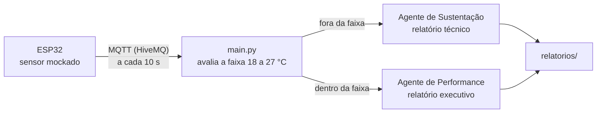

# Agentes de IA com ESP32 e MQTT

Um sensor de temperatura de rack publica leituras via **MQTT**, e um agente **CrewAI** decide sozinho para quem escrever o relatório: a **equipe de sustentação** quando o valor sai da faixa, ou a **direção** quando está tudo certo.



## O que ele faz

1. O **ESP32** ([`esp32_sensor_mock.ino`](esp32_sensor_mock/esp32_sensor_mock.ino)) conecta ao WiFi e publica uma leitura mockada de temperatura a cada 10 s no tópico `fiap/cp01/rack/temperatura`, no broker público `broker.hivemq.com`.
2. O **`main.py`** assina o tópico, recebe cada leitura e verifica se o valor está entre 18,0 °C e 27,0 °C.
3. Um agente CrewAI escreve o relatório certo para o público certo:
   - **fora da faixa:** *Engenheiro de Sustentação de Infraestrutura*, com desvio, causas prováveis e ação recomendada;
   - **dentro da faixa:** *Analista de Performance de Infraestrutura*, com status da operação e impacto positivo.
4. O relatório é salvo em [`relatorios/`](relatorios), com data, hora, dados da leitura e o texto gerado.

Sem o ESP32 físico, o [`sensor_publisher.py`](sensor_publisher.py) publica leituras mockadas direto do computador e permite testar o fluxo de ponta a ponta.

## Exemplo de saída

Trecho de um relatório real para a equipe de sustentação, gerado com uma leitura de 29,0 °C (arquivo completo em [`relatorios/2026-08-30_13-11-51_sustentacao.md`](relatorios/2026-08-30_13-11-51_sustentacao.md)):

> **Desvio:** o sensor de temperatura do rack apresentou leitura fora da faixa aceitável, registrando 29.0°C às 08:40, acima do limite máximo estabelecido de 27.0°C.
>
> **Causas prováveis:** falha ou insuficiência na climatização local; acúmulo de poeira ou obstrução das entradas de ar; sobrecarga de equipamentos no rack; sensor com possível falha ou calibragem incorreta.
>
> **Ação recomendada:** verificar a climatização, inspecionar e limpar o rack, analisar a carga dos equipamentos, conferir a calibração do sensor e monitorar em intervalos curtos.

## Tecnologias

- Python 3.13, [CrewAI](https://www.crewai.com/), `paho-mqtt`, `python-dotenv`
- ESP32 (Arduino IDE) com as bibliotecas `WiFi.h` e `PubSubClient`
- Broker MQTT público HiveMQ

## Limitações

- O sensor é **simulado**: o ESP32 publica valores de exemplo, não lê um sensor real.
- Precisa de uma chave da OpenAI para o agente gerar os relatórios.
- O broker HiveMQ é público e sem autenticação, adequado para a demonstração e não para produção.

## Como rodar

### 1. App Python (CrewAI + MQTT)

Dentro da pasta do projeto, com [`uv`](https://docs.astral.sh/uv/) instalado:

```bash
uv sync
```

Crie um arquivo `.env` na raiz do projeto com sua chave da OpenAI:

```
OPENAI_API_KEY=sua_chave_aqui
```

Depois rode:

```bash
uv run python main.py
```

### 2. Firmware do ESP32

1. No Arduino IDE, instale o core **esp32 by Espressif Systems** e a biblioteca **PubSubClient**.
2. Abra a pasta [`esp32_sensor_mock`](esp32_sensor_mock) no IDE.
3. Crie o arquivo `esp32_sensor_mock/arduino_secrets.h` (não versionado) com:

   ```cpp
   #pragma once
   #define WIFI_SSID "sua_rede"
   #define WIFI_SENHA "sua_senha"
   ```

4. Selecione a placa **ESP32 Dev Module** e a porta correta, compile e faça o upload.
5. Abra o Serial Monitor (115200 baud) para acompanhar a conexão e as publicações.

## Estrutura

```
.
├── main.py                          # App CrewAI que escuta o MQTT e gera os relatórios
├── sensor_publisher.py              # Publisher mockado alternativo (sem ESP32 físico)
├── esp32_sensor_mock/
│   ├── esp32_sensor_mock.ino        # Firmware do ESP32 (sensor mockado + MQTT)
│   └── arduino_secrets.h            # Credenciais de WiFi (não versionado)
└── relatorios/                      # Relatórios gerados pelo agente, um arquivo por leitura
```

## Time

Projeto de Edge Computing, FIAP. André Nobrega, Caio Carminato, Guilherme Tamai, Mirella Mascarenhas e Vitor Komura.
